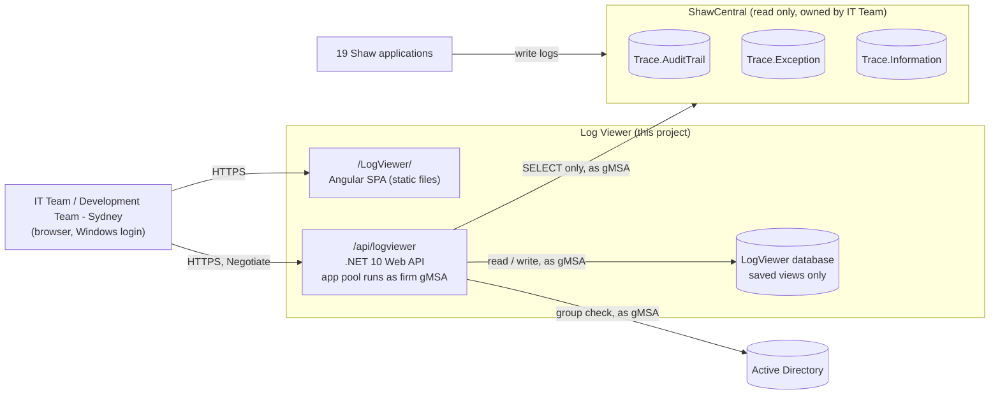
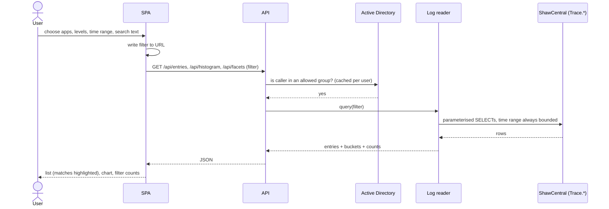
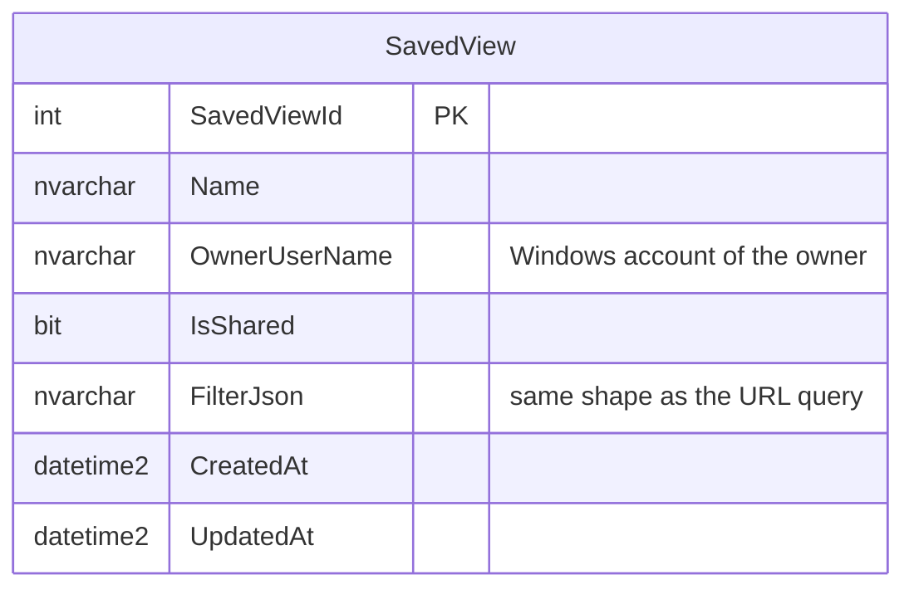

# Architecture: Log Viewer

> Status: APPROVED
> Version: v6
> Last updated: 2026-11-10
> PRD: docs/prd.md (built against v9)

## 1. System Context

The log viewer is an internal web app. Staff open it in a browser on the Shaw network and sign in
with their Windows login. It reads three existing log tables in `ShawCentral` and writes only to a
small database of its own that holds saved views.

A context diagram fits here because the point is the boundary: what the viewer owns and what it
only reads.

## 2. High-Level Architecture

Two IIS applications on the one intranet host, deployed under the firm's IIS Deployment Standard
the same way as `shaw-plugin-dashboard` ([ADR-001](adr/ADR-001-intranet-iis-under-the-firm-deployment-standard.md)):
the Angular SPA as static files at `/LogViewer/`, and a .NET 10 (Gen-3) Web API at `/api/logviewer`
in its own app pool. Same host means same origin: no CORS, and the browser's Windows sign-in just
works. The API's app pool runs as the firm's gMSA, and every database connection is Windows
Integrated Security as that account — no SQL user names or passwords in any deployed file
([ADR-007](adr/ADR-007-gmsa-identity-and-integrated-security.md)).

- **SPA** — Angular with Angular Material. One main screen modelled on a familiar log-search
  layout: search box and time range across the top; a volume chart; a filter panel on the left
  with counts per application, level and server; the results list; a saved-views menu; a live
  toggle.
- **API** — read endpoints over the logs (entries, volume histogram, facet counts, app summary)
  and CRUD endpoints for saved views. Every endpoint requires an authenticated user in one of the
  two allowed groups ([ADR-002](adr/ADR-002-windows-auth-and-ad-group-access.md)).
- **Log reader** — the only code that touches `ShawCentral`. It presents the three tables as one
  stream of **log entries** with a common shape and a derived **level**
  ([ADR-003](adr/ADR-003-read-trace-tables-directly-as-one-stream.md)).
- **Saved-view store** — the only data the app owns
  ([ADR-005](adr/ADR-005-saved-views-in-app-owned-database.md)).
- **Live mode** — the SPA polls for entries newer than the last one it holds
  ([ADR-004](adr/ADR-004-live-mode-by-polling.md)).

## 3. Components

### SPA (Angular + Angular Material)
- **Responsibility:** All user interaction: filters, search, time range, chart, results, entry
  detail, saved views, live mode. The full view state lives in the URL query string, so any
  screen is a shareable link (US-11). The API address comes from Angular environment files
  (`environment.prod.ts`: `apiBaseUrl: '/api/logviewer'`, swapped by `fileReplacements`); the
  production build uses `--base-href /LogViewer/`.
- **Inputs:** User actions; API JSON.
- **Outputs:** API requests.
- **Dependencies:** LogViewer API.
- **Technology:** Angular (current major) with Angular Material and the CDK — `mat-toolbar`,
  `mat-form-field`, `mat-select`, `mat-chip`, `mat-datepicker`, `mat-menu`, `mat-dialog`,
  `mat-slide-toggle`, `mat-expansion-panel`, `mat-progress-bar`, and CDK virtual scrolling for the
  results list. Volume chart drawn with ECharts via `ngx-echarts`
  ([ADR-006](adr/ADR-006-echarts-for-volume-chart.md)). Search-match highlighting is done in the
  SPA on the text it already holds.

### LogViewer API (.NET 10)
- **Responsibility:** Authenticate, authorise, validate query parameters, call the log reader and
  saved-view store, return JSON.
- **Inputs:** HTTP requests carrying a filter: applications, levels, servers, actions, users, text
  search, time from/to, page cursor.
- **Outputs:** JSON: a page of entries, histogram buckets, facet counts, app summaries, saved views.
- **Dependencies:** Active Directory (via `Shaw.ActiveDirectory`), log reader, saved-view store.
- **Technology:** ASP.NET Core minimal hosting, in-process under IIS,
  `Microsoft.AspNetCore.Authentication.Negotiate`, `Shaw.ActiveDirectory`, Scalar/OpenAPI docs in
  Development. Routes sit at the application root (`/entries`, `/histogram`, `/facets`, `/apps`,
  `/views`, `/configuration`); IIS supplies `/api/logviewer`. `GET /configuration` returns
  `webAPIVersion` and `loginUser.networkUsername` for the deploy smoke test, never a setting. No
  `Shaw.Configuration` central config: the server administrator has called
  `ShawCentral.dbo.Configuration` legacy. Structure follows
  `WebApis\PersonalContactUpdatePIS` (one project, folder per layer), auth wiring follows
  `WebApis\PhoenixV3WebAPI\Phoenix.WebAPI`.

### Log reader
- **Responsibility:** Turn a filter into read-only, parameterised queries over the three `Trace`
  tables and map rows to log entries.
- **Inputs:** A validated filter.
- **Outputs:** Log entries, histogram buckets, facet counts, per-app last-seen and recent error
  counts.
- **Dependencies:** `ShawCentral` (`Trace.AuditTrail`, `Trace.Exception`, `Trace.Information`).
- **Technology:** `Shaw.DataAccess` (never EF Core). SELECT only. Deployed, it connects with Integrated
  Security as the app pool's gMSA (ADR-007). In development it uses the `DatabaseReader` SQL login,
  with the password held in .NET user secrets, never in a tracked file.

### Saved-view store
- **Responsibility:** Save, list, rename, share/unshare and delete views. A view is a name, an
  owner, a shared flag and the filter as JSON. No log data.
- **Inputs:** Owner (from the signed-in identity), view data.
- **Outputs:** Views the caller owns plus views others have shared.
- **Dependencies:** LogViewer database.
- **Technology:** `Shaw.DataAccess`. Schema as numbered SQL scripts embedded in the API and applied
  by DbUp on start-up. SQL Server LocalDB in development; the `LogViewer` database on
  `idb_ag.shawstock.com.au,4433` when deployed, created empty by the developer before the first
  release ([ADR-005](adr/ADR-005-saved-views-in-app-owned-database.md)).

## 4. Data Flow

### Search (primary use case)

A sequence diagram fits because the value is in the order of calls and who answers each.

### Live mode

1. The user turns live mode on. The SPA keeps the current filter but sets the end of the range to
   "now".
2. Every 30 seconds the SPA asks for entries newer than the newest one it holds
   (`GET /api/entries?after=<timestamp>&…`).
3. New entries are added to the top of the list. The chart's last bucket is refreshed.
4. Polling pauses while the browser tab is hidden and stops when live mode is turned off.

### Unified log entry

| Field | AuditTrail | Exception | Information |
|---|---|---|---|
| Timestamp | `Timestamp` | `Timestamp` | `Timestamp` |
| Application | `ApplicationName` | `ApplicationName` | `ApplicationName` |
| Kind | `Audit` | `Error` | `Info` |
| Level | `Important` if `Important = 1`, else `Audit` | `Error` | `Info` |
| Server | `Server` | `Server` | `Server` |
| User | `UserId` | `UserId` | `UserId` |
| Message | `Details` | `Details` | `Details` |
| Action | `Action` | — | — |
| Method / FilePath | — | `Method`, `FilePath` | `Method`, `FilePath` |
| TargetId / Records | `TargetId`, `Records` | — | — |

Entries are ordered newest first by `Timestamp`, then a deterministic tie-break, and paged by
cursor (the last timestamp plus tie-break), never by offset.

### Saved views

## 5. Functional Requirements

| ID | Requirement | Source (PRD story) | Priority |
|----|-------------|-------------------|----------|
| FR-001 | List log entries from all three tables as one stream, newest first, filtered to one or more applications | US-1 | Must |
| FR-002 | Every entry carries a level (Error, Important, Info, Audit) shown as a coloured marker; filter by level | US-2 | Must |
| FR-003 | Time range: presets (15 min, 1 h, 4 h, 24 h, 7 d, 30 d) and exact from/to. Default: last 15 minutes | US-3 | Must |
| FR-004 | Filter by server, action and user | US-4 | Must |
| FR-005 | Text search over message text (and Method for errors/info); matches highlighted in results | US-5 | Must |
| FR-006 | Volume histogram over the selected range, stacked by application, bucket size chosen from the range | US-6 | Must |
| FR-007 | Filter panel with counts per application, level and server for the current results; click to filter | US-7 | Must |
| FR-008 | Toggle between one line per entry and full text; open a single entry in a detail panel with every field | US-8 | Must |
| FR-009 | Live mode: new entries appear at the top within 30 seconds of being written | US-9 | Must |
| FR-010 | App summary: per application, last entry time and error count over the last 24 hours | US-10 | Should |
| FR-011 | Full view state is in the URL, so copying the address shares the exact view | US-11 | Must |
| FR-012 | Save, rename, delete and reopen named views | US-12 | Must |
| FR-013 | Owner can share or unshare a view with all permitted users; others can open but not change it | US-13 | Must |
| FR-014 | Access only for members of `Development Team - Sydney` or `IT Team` | PRD Constraints | Must |
| FR-015 | A setting in the UI to change the maximum range for text searches with no application picked (default 7 days); kept in the URL and in saved views | US-5 | Should |

## 6. Non-Functional Requirements

| ID | Category | Requirement | Notes |
|----|----------|-------------|-------|
| NFR-001 | Performance | A filtered result page (50 entries; more load on scroll) plus histogram and facets return in under 2 s | PRD success metric. Queries always bounded by time; `Timestamp` is the clustered key on all three tables |
| NFR-002 | Performance | Text search without an application filter is limited to a maximum range, default 7 days, which the user can change in the UI. When raised above the default, the UI warns that the search may be slow | No full-text index exists on these tables; a `LIKE` over a year of rows would miss NFR-001. See A3 |
| NFR-003 | Performance | Live polling every 30 s per open live tab; each poll touches only rows newer than the last seen | Keeps load on the shared server small |
| NFR-004 | Security | Windows authentication on every request; group membership checked server-side | ADR-002 |
| NFR-005 | Security | Log access is SELECT only, with parameterised SQL; no dynamic SQL from user text | |
| NFR-006 | Security | Saved views store filters only; the owner is taken from the signed-in identity, never from the request | |
| NFR-007 | Reliability | If `ShawCentral` is unreachable, the SPA shows a clear error and keeps the current filter | |
| NFR-008 | Usability | All interactive controls are Angular Material / CDK components; keyboard accessible | Shaw UI standard |
| NFR-009 | Compatibility | Current Edge and Chrome on Shaw desktops | |

## 7. Technology Decisions

| Concern | Choice | ADR | Rationale |
|---------|--------|-----|-----------|
| Hosting & deployment | `sic2iws1` intranet IIS under the firm's IIS Deployment Standard: SPA at `/LogViewer/`, API at `/api/logviewer` in its own pool, `deploy/deploy.ps1` | ADR-001 | The firm standard, as applied by `shaw-plugin-dashboard` |
| Service identity & connections | App pool runs as the firm gMSA; every connection is Integrated Security; production strings in `appsettings.Production.json`, guarded by a test | ADR-007 | How every Shaw app runs; no secrets to manage |
| Authentication & access | Windows (Negotiate) auth + AD group check for two groups via `Shaw.ActiveDirectory` | ADR-002 | Estate pattern (`Phoenix.WebAPI`); staff already signed in |
| Reading logs | Direct read-only SQL over the three `Trace` tables via `Shaw.DataAccess`, mapped to one entry shape | ADR-003 | Logs already in one place; no copy needed |
| Live mode | SPA polling every 30 s for newer entries | ADR-004 | Meets 30 s target without a push channel; light load |
| Saved views store | App-owned `LogViewer` database (LocalDB in development); tables created by DbUp on start-up | ADR-005 | Read-only login cannot write; same approach as `shaw-plugin-dashboard` |
| Volume chart | ECharts via `ngx-echarts` | ADR-006 | Already used by `Websites\PhoenixV3` on Angular 20 |
| Data access library | `Shaw.DataAccess` | — | Shaw standard, not a choice with alternatives here |
| UI components | Angular Material / CDK | — | Shaw standard |

## 8. Open Questions & Risks

| ID | Question / Risk | Impact | Likelihood | Owner | Resolved? |
|----|----------------|--------|------------|-------|-----------|
| A1 | Which SQL identity does the deployed app use? | High | Low | Muhammed Ali Khan | Yes — the firm gMSA via Integrated Security (ADR-007). The gMSA already has access to every database on the server, new ones included (administrator, 2026-10-12, recorded in `shaw-plugin-dashboard` `docs/deployment/README.md`) |
| A2 | Where is the app hosted when deployed? | Medium | Low | Muhammed Ali Khan | Yes — `sic2iws1`: `https://intranet.shawandpartners.com.au/LogViewer/` and `/api/logviewer` (ADR-001). An administrator creates the `LogViewer` app pool and IIS application once (DEP-8) |
| A3 | Text search uses `LIKE` over `Details` (no full-text index). Wide searches could be slow and add load to a shared server. Mitigated by NFR-002 (adjustable range cap). A request to the IT Team for a full-text index goes into the PMBook as a later item | Medium | Medium | Muhammed Ali Khan | No — mitigated; follow-up item in PMBook |
| A4 | Live polling from many open tabs adds steady load to `ShawCentral`. Expected users are few (two groups), so low | Low | Low | Muhammed Ali Khan | No |
| A5 | Saved views in LocalDB live on each developer's machine, so sharing only works between users of the same machine until the dedicated database exists | Low | High | Muhammed Ali Khan | Accepted — development only |
| A6 | `UserId` in `Trace.Exception`/`Trace.Information` is `varchar(50)` vs `nvarchar(100)` in `Trace.AuditTrail`; values may be formatted differently across tables, which would split the user filter | Low | Low | Muhammed Ali Khan | Yes — checked 2026-11-10: no value in any of the three tables has a domain prefix or `@`, so all are bare usernames. Many rows have no user (most Information rows) — the user filter must handle blanks |

## 9. Security & Compliance Checklist

Triggered: the system has authentication and shows personal data (staff identities in log entries).

| Check | Status | Note |
|-------|--------|------|
| Data classification — what sensitive data types are stored/processed? | Addressed | Staff identities and free-text log details, read only. Nothing stored by the app except saved filters |
| AuthN/AuthZ approach named and covered by an ADR? | Addressed | ADR-002 |
| Data-at-rest / in-transit protection addressed? | Addressed | HTTPS to the host; encrypted SQL connections (`TrustServerCertificate` only in development). No log data at rest in the app |
| Least-privilege boundaries between components? | Addressed | The app runs as the firm's shared gMSA, which by firm design can reach every database on the server; a per-app login was rejected for `shaw-plugin-dashboard` by the product owner for that reason. Least privilege is enforced in code: the log reader issues SELECT only, and only the saved-view store writes, only to `LogViewer` |
| Applicable compliance regime (or "None") and how it's addressed? | Addressed | None beyond Shaw internal policy; access limited to two IT groups |

## Version History

| Version | Date | Change | Triggered By | Approved By |
|---------|------|--------|---------------|-------------|
| v1 | 2026-11-10 | Initial draft | — | — |
| v2 | 2026-11-10 | Text-search range cap made adjustable in the UI (NFR-002, FR-015). A1 resolved: deployed app connects with Integrated Security under its app pool account (estate pattern); development uses DatabaseReader via user secrets. Least-privilege check addressed | Triage edit | — |
| v3 | 2026-11-10 | Deployment and identity aligned with `shaw-plugin-dashboard`: firm IIS standard on `sic2iws1` (ADR-001 rewritten), gMSA with Integrated Security (new ADR-007), saved-views DB created empty and migrated by DbUp (ADR-005 updated), no `Shaw.Configuration`. A1, A2 resolved | Triage edit | — |
| v4 | 2026-11-10 | Defaults set by owner: initial range last 15 minutes; page size 50. A3 follow-up (full-text index request to IT Team) noted for the PMBook | Triage edit | — |
| v5 | 2026-11-10 | Live polling interval 30 s (owner default); FR-009 target 30 s; PRD metric moved to match (PRD v9) | Triage edit | — |
| v6 | 2026-11-10 | Architecture approved; ADR-001 to ADR-007 accepted | Gate approval | Muhammed Ali Khan |
